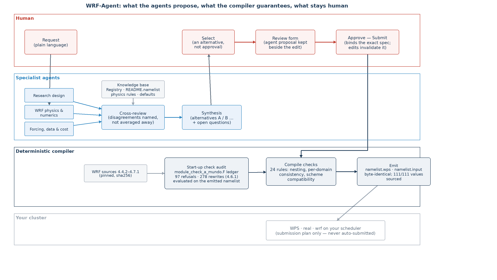

# WRF-Agent

**A multi-agent framework that turns a plain-language request into checked WRF experiment configurations — and
keeps the model's own rules between the request and the namelist.**

WRF-Agent automates the configuration half of a WRF workflow: planning the experiment with independent
specialist agents, recording every decision a human makes, compiling the specification into `namelist.wps` /
`namelist.input` deterministically, and auditing what WRF itself would do to those values at start-up — before
anything is submitted. It does not run WRF for you: the run lifecycle beyond emission (WPS, real, wrf, your
scheduler) stays with you, by design.



## Key features

- **Verified-first generation.** Language-model agents never edit namelists. They propose a *specification*;
  a deterministic compiler turns it into files, and every emitted value carries its source (specified, derived,
  default, deferred). Violations are refused before anything is written.
- **WRF's own rules, derived from the model source.** `check_a_mundo.F` of WRF 4.4.2 / 4.5.1 / 4.6.1 / 4.7.1 is
  extracted into a ledger: 97 conditions that refuse a configuration and 278 that replace a value in 4.6.1 —
  with the level at which each one is printed. `startup_checks` evaluates that ledger on the generated namelist,
  so a silent rewrite (e.g. `sf_urban_physics = 0,0,3` becoming `3,3,3`) is shown before the run.
- **Multi-agent deliberation with a human decision surface.** Independent specialist proposals, cross-review,
  and a synthesis that keeps disagreements as alternatives; a person selects, edits are recorded next to the
  agent's proposal, and approval binds to the exact specification (post-approval edits invalidate it).
- **Case lifecycle as an executable state machine.** One journal per case (`flow-run` / `flow-status`), stage
  gates, retries, and no LLM call after approval.
- **Studio + MCP.** `wrf-agent-studio` serves a single-page dashboard with the stage board, the review form and
  an in-page agent chat; the same case tools are exposed over MCP for external agents.
- **Batch expansion.** A design matrix (namelist axes + URBPARM axes such as roof/wall albedo) expands into
  member bundles verified to differ only on the declared factors.

## Quick start

```bash
python -m pip install -e ".[test]"          # Python >= 3.10
python -m src.userguide parse --build wrf461-dmpar   # parameter registry from the pinned snapshot (offline)
```

Deterministic demo — no model, no network:

```bash
python wrfa_demo.py --output ./demo_out --no-llm
```

With a model (any OpenAI-compatible endpoint):

```bash
export WRF_AGENT_LLM_BASE_URL=... WRF_AGENT_LLM_API_KEY=... WRF_AGENT_LLM_MODEL=...
python wrfa_demo.py --output ./demo_out          # discuss -> select -> approve -> compile -> emit
wrf-agent-studio mycase --request "$(cat user_requirement.txt)"   # or the interactive studio
```

Reproduce the measurements in `docs/measurements/`:

```bash
python -m src.userguide.measure_audit        # -> docs/measurements/audit_numbers.{json,md}
python -m src.userguide.measure_fidelity     # fault injection, approval binding, determinism, start-up checks
python -m pytest -q
```

## What is measured (and what is not)

| property | result |
|---|---|
| start-up checks extracted from `module_check_a_mundo.F` | 97 refusals / 278 rewrites (4.6.1); 95 / 21 printed at the default debug level |
| rewrites that replace a study-defining value | 21 statements on 9 parameters, 4 of them announced |
| rule inventory (checks.py) | 27 ids: 19 enforcing, 5 informational, 3 deferred to launch |
| single-field fault injection | 29/29 detected with the expected status |
| approval binding | 5/5 post-approval edits invalidate approval; 3/3 non-edits keep it |
| generation | byte-identical re-emission; 111/111 parameters carry a source |
| start-up checks decidable before the run | refusals 78/85, rewrites 241/268 (this build) |

These are measurements of this release on the pinned WRF sources and the recorded build, not guarantees for
arbitrary cases; `docs/measurements/*.yaml|json` carry the definitions and the exact numbers.

## Repository layout

```
src/userguide/        docs ingest (Registry/README.namelist), field map, compile checks, emitter,
                      start-up check audit, measurements, batch, studio, agent chat
src/userguide/flow/   the case lifecycle: state machine, gates, specialists, discussion, study harness
src/wrfkit/data/      the WRF knowledge base (physics compatibility, domain rules, defaults, sources)
references/upstream/  pinned WRF 4.6.1 snapshot (Registry, README.namelist, start-up sources 4.4.2–4.7.1,
                      one recorded build profile) — Users' Guide HTML is fetched, not redistributed
cases/                example case (Singapore albedo sensitivity)
docs/measurements/    definitions + measured numbers
tests/                unit tests for everything above
```

Not in this repository: job submission and cluster monitoring (the layer is host-specific; the pipeline ends at
emission plus a submission *plan*), and any WRF runtime.

## Limitations

- The constraint set encodes a subset of the audited behaviours; `coverage` in `measure_audit` reports how much.
- Only the start-up consistency routine is audited; failures that appear during integration (CFL violations after
  the first steps, input-data problems) are launch-time checks or out of scope.
- Windows/macOS are untested; the knowledge base targets WRF 4.6.x / ARW.

## Citation

See `CITATION.cff`. A paper describing the configuration-fidelity study is under review.

## License

MIT (this code). WRF source files under `references/upstream/` are redistributed from the public
`wrf-model/WRF` repository under its own terms.
